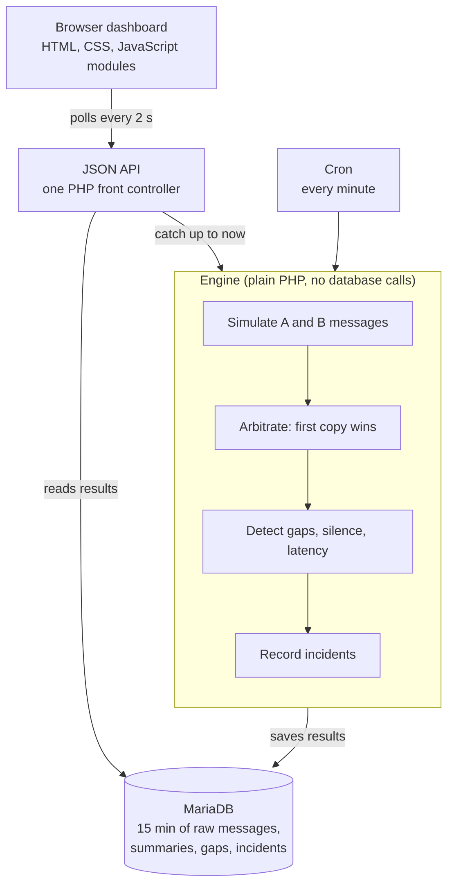

# FeedWatch

**A real-time market data feed health monitor.** FeedWatch watches simulated stock exchange feeds and raises the alarm when one goes slow, drops messages or fails over to its backup route.

*Inspired by the monitoring dashboards that market data network providers offer their clients. All exchanges and data are fictional.*

**Live demo: [oscar.illand.co.uk/feedwatch](https://oscar.illand.co.uk/feedwatch/)**. Its **About** page explains the problem, how it works and how it was built, in plain words.

## The problem

Exchanges publish a non-stop stream of small, numbered messages. Trading firms receive every message twice, over an **A** and a **B** network route, and keep whichever copy arrives first. If a number is skipped (a **gap**), or one route slows down or goes silent, a firm's view of the market is wrong or one failure away from it. Operations teams need to see that as it happens.

## What it does

- Simulates eight fictional exchanges, each sending numbered messages on an A and a B feed.
- Keeps the first copy of each message and drops the duplicate, showing how often A wins compared with B.
- Detects gaps, and tells a gap the other feed covered (lost redundancy) from true data loss on both.
- Spots failover, when one route goes silent and the other carries everything.
- Charts latency per feed against a learned baseline.
- Records every problem as an incident, with a timeline and an honest duration.
- Includes a chaos panel, behind an admin login, to break things on purpose and watch the dashboard react.

## Architecture



Shared hosting can't run a program in the background, so there is no always-running simulator. Each request asks the engine "what should have happened since last time?", and the engine generates exactly that under a database lock, checks it and saves it. Cron runs the same catch-up every minute, and stops after 30 minutes without viewers so the demo costs the server almost nothing. The engine is pure logic, with time and randomness passed in, so it is deterministic and tested exhaustively.

| Part | Built with |
|---|---|
| Server | PHP 8.4, no framework; Composer for autoloading and dev tools only |
| Database | MariaDB 10.5 through PDO, prepared statements only |
| Browser | HTML, CSS and JavaScript modules, no build step; Leaflet for the map and Chart.js for the chart, both vendored |
| Quality | PHPUnit (unit tests, plus database integration tests in CI), PHPStan level 9, browser tests for the JavaScript modules (`public/assets/js/tests/`), colours checked against WCAG 2.2 AA |
| Security | Hashed admin password, rate-limited login, CSRF tokens, strict Content Security Policy, private code blocked from the web, a smoke test after every deploy |

## Where to look

| Path | What's there |
|---|---|
| `app/Simulation/` | Message generation: a function of time, with hash-based randomness so any slice of time gives the same answer |
| `app/Detection/` | Arbitration, gap detection, failover, latency statistics and the incident tracker. Pure logic |
| `app/Infrastructure/` | The only code that touches the database: the catch-up runner, repositories and migrations |
| `app/Http/` | Router, controllers, admin login, CSRF and security headers |
| `public/` | The web root: the front controller and the dashboard's JavaScript modules and styles |
| `database/migrations/` | The schema, one numbered SQL file per change |
| `tests/` | Unit tests, and integration tests against MariaDB |

## Design decisions

Each significant choice was made through a written decision record with the options, trade-offs and reasons:

- **No framework:** about a dozen routes and one database don't need one, and every line stays explainable.
- **Store summaries, not every message:** raw messages are kept for 15 minutes, then summarised per second and per minute, within a 100 MB budget.
- **Catch up on read, not a background process:** shared hosting has no daemons, so each request simulates the time since the last one.
- **Polling, not websockets:** every 2 seconds, with a one-second server cache so many viewers cost about one catch-up a second.
- **Leaflet with online tiles:** a real, zoomable map that still shows the exchanges if the tiles can't load.
- **An admin login for the chaos panel:** visitors are read-only, see a banner while a fault is active, and every fault undoes itself after 5 minutes.
- **Chart.js, vendored:** a clear latency chart with no build step.

## Running it locally

You need PHP 8.4 (with `curl`, `intl`, `mbstring`, `openssl` and `pdo_mysql`) and Composer.

```bash
composer install
composer check          # PHP lint, PHPUnit and PHPStan
php -S 127.0.0.1:8080 -t public
```

Then open `http://127.0.0.1:8080/` (the app's base path comes from the `APP_BASE_PATH` setting). The About page works straight away. The live dashboard needs a MariaDB 10.5 database: set the `DB_*` environment variables, and run `php bin/cron.php` once to apply the migrations. Database integration tests run when `FEEDWATCH_TEST_DB=1` and the `DB_*` settings point at a disposable database.

## Built with AI assistance

FeedWatch was built with AI coding agents doing much of the drafting and typing, inside a process designed to keep the design decisions with a person:

1. **Specify:** each feature is a requirement with checkable acceptance criteria.
2. **Decide:** each design choice gets a decision record with options and a recommendation; the author decides.
3. **Plan:** each slice of work gets a written plan, and no code is written until it is approved.
4. **Build:** code and tests together, and every change must pass the tests, static analysis and the contrast check.
5. **Explain:** every component has a 30-second explanation, so the author can explain all of it without notes.
6. **Release:** every deploy ends with a smoke test of the live site.

The coding rules the agents work to are in [AGENTS.md](AGENTS.md).

## What I'd do next

- Move the application code outside the web root instead of relying on `.htaccess` to block it.
- Deploy from CI instead of from a developer machine.
- A pre-market check screen, a status page with a written outage report, and planned-maintenance windows.
- At real scale: a long-running receiver, a time-series store, and pushing updates to the browser instead of polling.

## Licence

[MIT](LICENSE). Leaflet and Chart.js keep their own licences, next to their copies in `public/assets/vendor/`.
